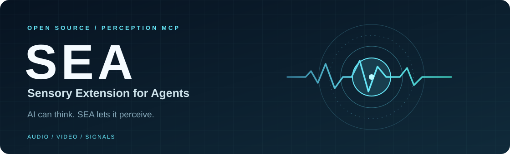
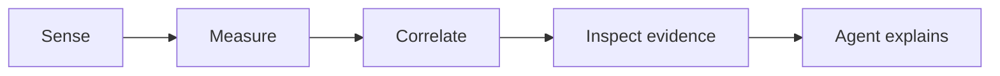
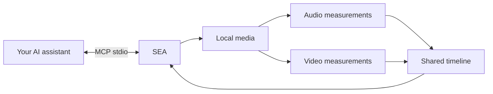

<div align="center">



# SEA — Sensory Extension for Agents

### Give your AI new senses.

**Give your AI measurable evidence from sound, video, images and recorded signals.**

[](https://github.com/PCTestAdmin/SEA/stargazers)
[](https://github.com/PCTestAdmin/SEA/actions/workflows/test.yml)
[](LICENSE)
[](https://modelcontextprotocol.io/)
[](pyproject.toml)
[](pyproject.toml)

[Quick start](#quick-start) · [Showcase](#showcase) · [How it works](#how-it-works) · [Capabilities](#capabilities) · [Roadmap](#roadmap) · [FAQ](#faq)

</div>

---

Most AI assistants can reason about a description. But descriptions alone cannot tell them the frequency of a sound, when an image changed, or whether both events appeared in the same recording segment.

**SEA gives your agent access to the measurements themselves.** It is a local Model Context Protocol (MCP) extension, not another chatbot. Connect it to your existing assistant, select a recording, and ask a question.

> [!NOTE]
> SEA is an early open-source prototype. Audio, video, image-space and recorded sensor measurements are implemented; live sensors, one-click desktop packages and semantic sound recognition are not yet available. Check the [live test results](https://github.com/PCTestAdmin/SEA/actions/workflows/test.yml) for platform verification.

## Quick start

**Requirements:** Python 3.10+, Git, FFmpeg and FFprobe available on PATH.

```bash
git clone https://github.com/PCTestAdmin/SEA.git
cd SEA
python -m pip install .
```

Create a dedicated media directory, close the client and run:

```bash
sea doctor
sea setup --client claude-desktop --media-root "/absolute/path/to/media"
```

Review the preview, then repeat with `--apply` to register SEA. Existing settings are preserved and the original config is backed up. Restart the client. Use `--client cursor` for Cursor, or `--config` for a compatible custom JSON configuration. Claude Desktop automatic path detection is limited to Windows and macOS.

Alternatively, install into a persistent isolated environment with `pipx install git+https://github.com/PCTestAdmin/SEA.git` (requires pipx and Git). SEA is not published on PyPI yet. See the [installation guide](docs/installation.md) for updates, troubleshooting and manual setup. No SEA account or API key is needed.

<details>
<summary><strong>Claude Desktop — configuration example</strong></summary>

Create a dedicated media folder and use the absolute path to the Python interpreter where SEA is installed. Merge this entry into your existing MCP configuration, replacing the example paths:

```json
{
  "mcpServers": {
    "sea": {
      "command": "/absolute/path/to/python",
      "args": ["-m", "sea.server"],
      "env": {
        "SEA_MEDIA_ROOTS": "/absolute/path/to/media"
      }
    }
  }
}
```

Restart the client. See the [Windows configuration and troubleshooting guide](docs/installation.md). Other clients with local MCP support can use the same command and environment.

</details>

**Try asking your agent:**

```text
Analyze my recording with SEA. Find unusual changes in
sound or image, tell me when they occur, and show me
the measurements behind your answer.
```

## Showcase

<div align="center">

</div>

### Can an AI locate a sound and a visual change in the same video?

Our reproducible six-second fixture contains a black scene, a white scene with a 440 Hz tone, and a return to black and quiet. SEA analyzes the audio and video on a shared approximate timeline.

| Evidence | Recorded result |
| :--- | :--- |
| Dominant frequency during tone | 440 Hz |
| Tone detected | Approximately 2–4 s |
| Visual change bins | 2 |
| Sampled video frames | 24 |
| Overall digital RMS level | −18.09 dBFS |

These are measurements from the synthetic test, not a live AI screenshot or a real-world benchmark. The illustration shows the reported tone and the known fixture scenes. Temporal overlap does not establish causation.

**Reproduce it yourself** — generate the fixture and ask your agent to inspect it:

```bash
python examples/make_demo.py /absolute/path/to/media/demo.mp4
```

[Demo generator](examples/make_demo.py) · [Recorded JSON evidence](examples/demo-report.json) · [Test assertions](tests/test_engine.py)

### Acoustic evidence

Ask your agent to locate level changes, inspect frequency peaks and compare two equally long recording segments. SEA returns 100 ms level measurements, a time-frequency image and numeric differences rather than a guessed sound label.

```text
Use SEA to analyze this recording. Locate abrupt level changes,
inspect the spectrogram, and compare it with my reference recording.
Distinguish measured differences from possible explanations.
```

[Acoustic analysis guide](docs/acoustics.md) · [Reproducible acoustic tests](tests/test_acoustics.py)

### Investigate, don't just inspect

`investigate_media` brings the audio and visual engines together. It assigns evidence IDs, matches nearby point events and recommends timestamps for deeper frame inspection. The agent can then interpret and cross-check those observations.



```text
Investigate my video with SEA. Find changes in sound and image,
check whether they occur close together, then inspect the most
relevant frames. Explain the evidence and what remains unknown.
```

[Investigation guide](docs/investigation.md) · [Reproducible tests](tests/test_vision.py)

### New in v0.7 — autonomous coarse-to-fine investigation

SEA can survey a recording, rank measured changes, revisit up to two promising windows and expose what it did not inspect. It operates within a bounded local decoding budget.

```text
Survey my recording with SEA. Investigate the strongest audio
and visual changes, inspect relevant frames, and tell me which
parts were not analyzed. Separate observations from hypotheses.
```

[Autonomous survey guide](docs/survey.md) · [Survey tests](tests/test_survey.py)

## What could you use SEA for?

<table>
<tr>
<td width="50%" valign="top"><h3>Everyday recordings</h3><p>Find the time at which an unusual sound or visual change occurs in a recording. Inspect that segment instead of searching manually.</p></td>
<td width="50%" valign="top"><h3>Creators &amp; musicians</h3><p>Compare digital audio levels, find quiet sections and inspect the dominant frequency of a recorded tone.</p></td>
</tr>
<tr>
<td valign="top"><h3>Gamers &amp; streamers</h3><p>Locate large visual transitions or quiet audio intervals in a captured gameplay or stream clip.</p></td>
<td valign="top"><h3>Developers &amp; IT</h3><p>Investigate a screen recording of an issue, find relevant visual changes and request timestamp-selected frames.</p></td>
</tr>
</table>

These are suggested workflows using the current measurements, not claims that SEA recognizes every event or diagnoses its cause.

## How it works



SEA uses FFmpeg to decode selected local media and NumPy to calculate signal features. The agent receives structured results and can request a particular frame for closer inspection. It decides how to interpret the evidence; SEA reports measurements and their limitations.

## Capabilities

| Tool | What your agent receives |
| :--- | :--- |
| `inspect_media` | Duration, stream metadata and codecs |
| `sense_media` | Audio levels, dominant frequency, quiet intervals and video differences on a half-second timeline |
| `view_frame` | A PNG near a requested video timestamp |
| `sense_audio` | Spectral peaks, band power, 100 ms levels and threshold events |
| `audio_spectrogram` | Time-frequency PNG for visual investigation |
| `compare_recordings` | Numeric differences between equally long audio segments |
| `sense_video` | Sampled visual activity, histogram shifts, change regions and static intervals |
| `investigate_media` | Evidence-indexed multimodal report, temporal matches and frame follow-ups |
| `inspect_spatial` | Image-space grid, regional color and contrast measurements |
| `inspect_region` | PNG crop of a selected normalized image region |
| `sense_signals` | Numeric sensor CSV statistics, change events and correlations |
| `investigate_recording` | Bounded multi-window survey, ranked candidates, targeted refinement and coverage gaps |

<details>
<summary><strong>Supported media and measurement limits</strong></summary>

| Input / parameter | Current support |
| :--- | :--- |
| Audio | WAV, MP3, FLAC, M4A, OGG, OPUS |
| Video | MP4, MOV, MKV, WebM |
| Still images | PNG, JPEG (spatial tools only) |
| Sensor logs | Numeric UTF-8 CSV, up to 2 MiB / 20,000 rows |
| Maximum file size | 2 GiB |
| Analysis window | 0.25–120 s visual, 0.25–30 s acoustic/investigation, 0.25–60 s combined legacy tool |
| Audio sampling | First audio stream, mono, 16 kHz |
| Video sampling | First video stream, grayscale, 160 × 90, 4 fps |
| Timeline | Approximate half-second bins |
| Survey span | Up to 30 min, sampled (not exhaustive) |

Decoder support depends on the FFmpeg installation. Frame differences are not object tracking or proof of movement. Audio levels are not calibrated physical loudness or proof of clipping. A dominant frequency does not identify a sound source. Exact audiovisual sync, speech transcription and semantic music analysis are outside the current scope.

</details>

## Privacy by design

- Local processing of explicitly configured media folders.
- No SEA cloud account, remote media URL input, microphone capture or background service.
- No uploads initiated by SEA. Tool results, including requested frames, are returned to your MCP host and may be transmitted to its model provider.
- Folder restrictions are not an operating-system sandbox. Use trusted media in a dedicated directory and keep FFmpeg updated.

See [installation and usage details](docs/installation.md).

## Roadmap

- [x] Local audio and video analysis engine
- [x] Structured MCP tool implementation
- [x] Reproducible audiovisual example
- [x] Preview-first client registration, backups and prerequisite checks
- [ ] Verified client integration and cross-platform installation
- [ ] One-click extension / package distribution
- [ ] More precise timestamp alignment and labeled benchmarks
- [x] Spectrograms, threshold-based audio event localization and recording comparisons
- [x] Evidence-indexed multimodal investigation and sampled visual change regions
- [x] Image-space spatial analysis and region inspection
- [x] Numeric sensor-log analysis and paired-channel correlations
- [x] Budgeted coarse-to-fine recording investigation
- [ ] Physical depth and live sensor integration
- [ ] Persistent perception memory and reusable evidence history

The long-term goal is a modular perception layer for AI agents. We prioritize features that yield observable, testable information rather than adding tools for their own sake.

## FAQ

<details>
<summary><strong>Is SEA an AI model?</strong></summary>

No. SEA adds media analysis tools to an existing assistant. It does not replace the model.

</details>

<details>
<summary><strong>Can I use it with Claude, Cursor or Codex?</strong></summary>

SEA exposes a local MCP stdio server. SEA provides configuration helpers for Claude Desktop and Cursor; compatible clients can also be configured manually. The current prototype does not claim verified compatibility with every client or platform; see the [setup guide](docs/installation.md).

</details>

<details>
<summary><strong>Can SEA understand music or diagnose an unusual noise?</strong></summary>

Not by itself. It can measure frequencies, levels and timestamps; interpreting a complex sound requires further evidence. No automatic source identification or machine diagnosis is implemented.

</details>

<details>
<summary><strong>Can I analyze files without an AI assistant?</strong></summary>

Yes. The same engine has a diagnostic CLI. See [command-line usage](docs/installation.md#command-line-usage).

</details>

<details>
<summary><strong>Does SEA need internet access?</strong></summary>

The media engine needs no network connection. Installing dependencies may require internet access, and your chosen AI host may use a cloud model.

</details>

## Documentation

| Guide | Content |
| :--- | :--- |
| [Installation & troubleshooting](docs/installation.md) | Prerequisites, platform configuration, CLI |
| [Autonomous survey](docs/survey.md) | Sampling plan, ranking, refinement and coverage |
| [Sensor signals](docs/signals.md) | CSV schema, thresholds and paired-channel analysis |
| [Spatial analysis](docs/spatial.md) | Image grids, normalized regions and crops |
| [Multimodal investigation](docs/investigation.md) | Visual measurements, correlation and follow-up workflow |
| [Acoustic analysis](docs/acoustics.md) | Spectrograms, measurements, comparisons and limitations |
| [Example evidence](examples/demo-report.json) | Structured demo output |
| [Development tests](tests/) | Engine and MCP integration tests |
| [License](LICENSE) | MIT |

## Contributing

SEA is at the beginning of its journey. If you find an interesting use case, [share it in an issue](https://github.com/PCTestAdmin/SEA/issues). Include the kind of media, the question you asked and what the agent could or could not determine. Avoid posting private recordings.

Bug reports, reproducible benchmarks, new analysis modules and documentation contributions are welcome.

<div align="center">

**If SEA gives your agent a useful new capability, consider [starring the project](https://github.com/PCTestAdmin/SEA).**

MIT licensed · Built in the open

</div>
